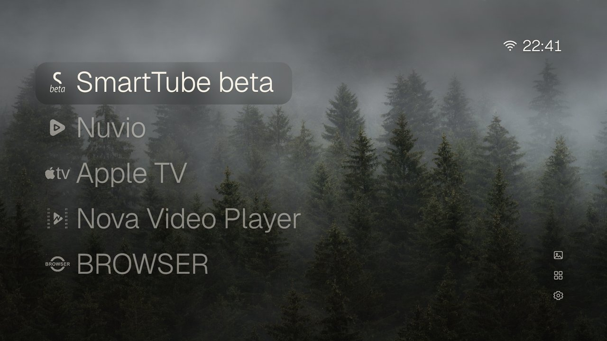
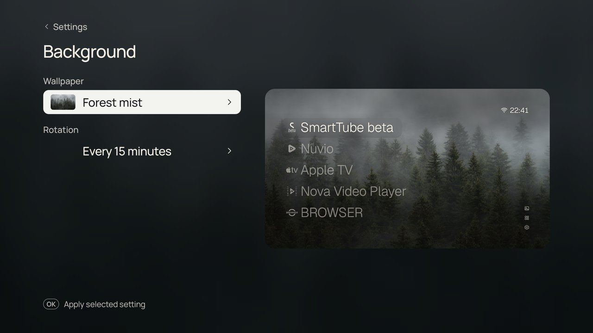

# Serene TV

A calm, light Home screen for Android TV.

Serene TV is a native take on [CleanFrame](https://github.com/nthnclrk/CleanFrame) by Nathan Clark, by way of
Mats Fjeldstad's [CleanFrame for Android TV](https://github.com/Matsfjeldstad/CleanFrame-AndroidTV). The design
is theirs: the photo wallpapers, the glass focus, the large list of apps, the quiet controls in the corner.
Serene TV redraws it with plain Android views instead of a web page in a WebView, so it needs no browser engine.

On a TCL Android 11 TV with 2 GB of RAM, the WebView version used about 150 MiB; Serene TV uses about 22 MiB
after a reboot and under 60 MiB after opening every screen.

## What it has

- Your apps as a list on a photo, with a frosted-glass focus. Hold OK on an app for Open, Remove from Home
  and App info.
- 15 photo wallpapers, and rotation: fixed, each time Home opens, or every 5, 15 or 60 minutes.
- All apps, and Apps on Home to reorder (OK picks an app up, Up/Down moves it, OK drops it), add, remove
  and undo. Up to nine apps on Home.
- The time and Wi-Fi signal, a shortcut to the TV's own settings, and a wallpaper-and-clock screensaver.
- An app you uninstall keeps its place on Home and returns there if you install it again.

It has one look: CleanFrame's List layout with Geist, glass focus and icons with names. No network
permission, no tracking.

## Build and install

Needs JDK 17 and the Android SDK (build-tools 34.0.0, platform 34). Android 8.0 or later on the TV.

    JAVA_HOME=/path/to/jdk-17 ./build.sh
    TV=192.168.1.50:5555 ./install.sh

There is no Gradle: `build.sh` runs aapt2, javac, d8 and apksigner directly. It signs with
`signing/debug.keystore`, which you provide (for example a copy of `~/.android/debug.keystore`). Keep that
file: the TV only accepts updates signed with the key it first saw, and installing with another key means
uninstalling first, which loses your Home order and settings.

To start with your own apps and wallpaper, put a `bootstrap.json` in `local/` (git-ignored):

    {"home": ["org.smarttube.beta", "com.netflix.ninja"], "wall": "forest", "mode": "15"}

Without one, Serene TV picks up to five installed streaming apps.

Then make it the screensaver too, if you like:

    adb shell settings put secure screensaver_components io.github.bavarianprayoga.serene/.Dream

## Code

- `src/.../HomeView.java`: every screen, the remote keys and animation, in 1920x1080 coordinates.
- `src/.../Look.java`: bakes each wallpaper's overlays into the photo and the glass textures once, so a frame
  is a few bitmap draws.
- `src/.../Apps.java`: installed apps and their monochrome marks, cached on disk.
- `src/.../Dream.java`: the screensaver.
- `assets/`: wallpapers, blurred materials, brand marks, fonts, and `theme.json` (each photo's overlay and
  ink values, measured from CleanFrame's computed styles). `tools/prepare-assets.py` regenerates it from a
  CleanFrame checkout.

## Credits

Design: [CleanFrame](https://github.com/nthnclrk/CleanFrame) by Nathan Clark (MIT) and
[CleanFrame for Android TV](https://github.com/Matsfjeldstad/CleanFrame-AndroidTV) by Mats Fjeldstad, whose
icon-mark extraction Serene TV ports. Photos from Unsplash (credits in `assets/licenses/wallpaper-sources.json`),
Geist and Manrope under the SIL Open Font License, brand marks from Simple Icons and the sets listed in
`assets/licenses/`. Brand names and logos belong to their owners.

MIT licence: see [LICENSE](LICENSE).
